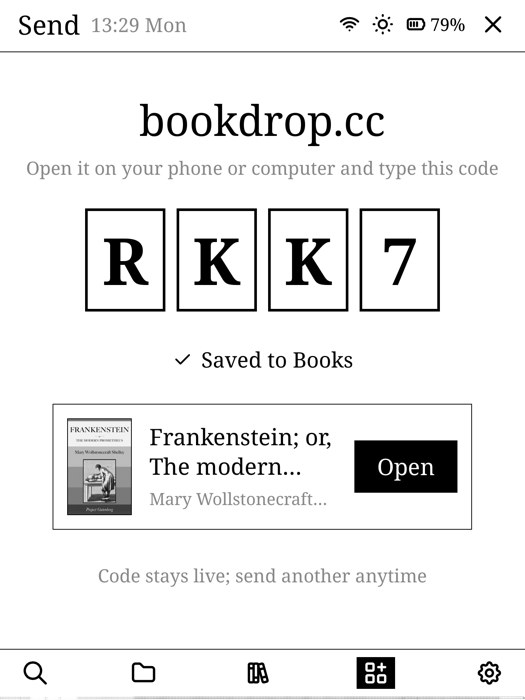
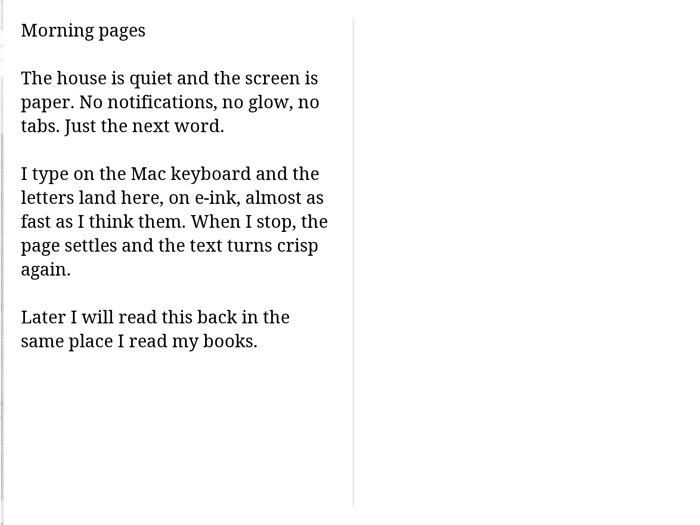

# ereader-skills

Make an old e-reader fast and pleasant on [KOReader](https://github.com/koreader/koreader), and let an AI agent (or you) work on it over Wi-Fi.

<p>



</p>

## Why
Stock e-reader software is slow and closed. KOReader is open but plain and fiddly to tune. This gives you:

- **Shelf**: a home screen with covers, your current book and reading time left. Covers are fetched online when a book has none.
- **Speed patches**: full CPU while reading, faster page turns, the reader menu ready before you tap.
- **Send**: open Send on the reader, type its 4-letter code at bookdrop.cc on your phone or Mac, drop a book. It lands in your library with an Open button. Long-press a book to send it to another reader the same way.
- **Straight into KOReader** (Kobo): the reader boots into KOReader with no taps (tap within 3 s to stay in the stock software), and the stock software is stopped while KOReader runs, so it has the CPU and memory to itself. Kindle: one tap on "KOReader" in the library does the same.
- **ink**: a command line tool to screenshot, tap, push books, change settings and hot-reload code on the reader from your Mac, with no cables.
- **Agent skills**: docs written for an AI agent. Point Claude Code (or any agent that reads files) at them and ask for changes; it edits, reloads and checks the screenshot itself.

## Build your own reader apps
The reader becomes a small computer you can program from your Mac. Edit a plugin, run `ink reload <name>` and it is back on screen in about 2 seconds, no restart, no cables. `ink shot` and `ink tap` let an agent see and use the screen, so it can build, test and fix on its own.

Example: **Writer**, a distraction-free typewriter. Type on the Mac keyboard and the words appear on the e-ink page as you type, in portrait or as a two-page landscape spread, saved as plain text notes. It was built this way, with Claude Code driving the reader. See [typewriter.md](typewriter/typewriter.md).



## Who it's for
People with a Kindle or Kobo (or any reader KOReader runs on) who want it faster and nicer, and tinkerers who want to build their own reader apps with an agent's help.

Tested daily on a Kindle Basic 7th gen and a Kobo Aura ONE. Other readers should work: every feature checks the hardware and hides what is missing.

## Install
On a Mac with [Homebrew](https://brew.sh):
```bash
git clone https://github.com/lukaskornis/ereader-skills && cd ereader-skills
./install.sh
```
Then follow [setup.md](setup.md): KOReader on the reader, SSH on, then
```bash
ink -d kobo find      # or -d kindle
ink -d kobo install   # Shelf and speed patches
```

## Use it with an agent
- Claude Code: `install.sh` adds the `ereader` skill. Ask "make the Shelf header bigger on my Kobo".
- Any other agent: tell it to read `_index.md` first.

## License
MIT. KOReader and the third-party tools fetched by `downloads/fetch.sh` keep their own licenses.
